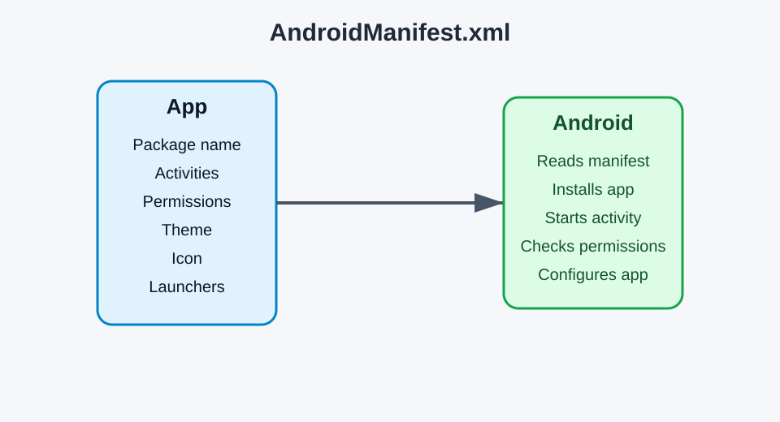

# Part 1 — What is the Android manifest?

[Previous: Tutorial home](README.md) | [Next: Strings and multilingual support](02-strings.md)

## Goal

Understand the purpose of the Android manifest and identify the most important information it contains.

---

## 1. Create the project

Create a new Android project in Android Studio: `PermissionDemo`

* Empty Activity
* Package name: `com.example.permissiondemo`
* Minimum SDK: API 24 or newer

Now look at the `AndroidManifest.xml` file:

This file is required for your app to run correctly.

---

## 2. What does the manifest contain?

The manifest tells Android important details such as:

- the app package name,
- the activities inside the app,
- the permissions used,
- the launcher activity,
- the app label and icon,
- the theme and app configuration.



A simple example looks like this:

```xml
<manifest xmlns:android="http://schemas.android.com/apk/res/android"
    package="com.example.permissiondemo">

    <application
        android:label="@string/app_name"
        android:icon="@mipmap/ic_launcher"
        android:theme="@style/Theme.PermissionDemo">

        <activity
            android:name=".MainActivity"
            android:exported="true">
            <intent-filter>
                <action android:name="android.intent.action.MAIN" />
                <category android:name="android.intent.category.LAUNCHER" />
            </intent-filter>
        </activity>
    </application>
</manifest>
```

---

## 3. Importance

The manifest is like the app's ID card. Without it, Android does not know how to start or configure the app.

It is also where we declare permissions such as:

- `SEND_SMS`
- `CALL_PHONE`
- `READ_CONTACTS`

These allow the app to perform protected actions only when the user allows them.

---

## 4. The app launch flow

Android reads the manifest and then starts the launcher activity.

This is why the manifest is one of the most important files in an Android application.

---

[Previous: Tutorial home](README.md) | [Next: Strings and multilingual support](02-strings.md)
