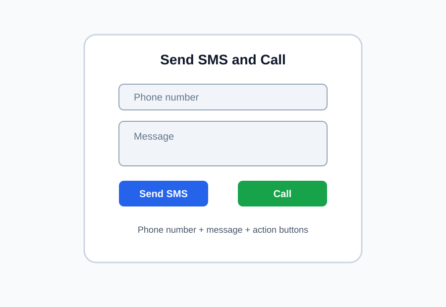

# Part 4 — Create the basic UI

[Previous: SMS and call permissions](03-permissions.md) | [Next: Practice and recap](05-practice.md)

## Goal

Create a simple user interface with fields for phone number and message, plus buttons for SMS and call actions.

---

## 1. The screen design

Our screen will include:

- a text field for the phone number,
- a text field for the message,
- a button to send SMS,
- a button to call.



---

## 2. Create the code

First, declare two variables used to remember the values typed by the user while the permission dialog is open.

```kotlin
class MainActivity : ComponentActivity() {
    private var pendingPhone = ""
    private var pendingMessage = ""
```

This is needed because Android asks permission in a separate step, and the values must still be available afterward.

---

Define a Composable for the UI INSIDE the `MainActivity` class. Here are the elements that we will define:

* `MaterialTheme` gives the app Material 3 styling.
* `remember` keeps the typed text values in memory.
* We use `OutlinedTextField` to create the phone number input field with:
    * `value = phone` shows the current text
    * `onValueChange` updates the variable when the user types
    * `label` shows the hint: `Phone number`
* The `message` field is very similar
* Buttons:
    * when the user clicks the SMS button, it calls `requestSmsPermission(phone, message)`
    * when the user clicks the call button, it calls `requestCallPermission(phone)`

---

```kotlin
@Composable
fun PhoneUI() {
    MaterialTheme {
        var phone by remember { mutableStateOf("") }
        var message by remember { mutableStateOf("") }

        Column(
            modifier = Modifier
                .fillMaxSize()
                .padding(24.dp),
            verticalArrangement = Arrangement.spacedBy(16.dp)
        ) {
            Text(
                text = stringResource(R.string.title),
                style = MaterialTheme.typography.headlineSmall
            )

            OutlinedTextField(
                value = phone,
                onValueChange = { phone = it },
                label = { Text(stringResource(R.string.phone_hint)) },
                modifier = Modifier.fillMaxWidth()
            )

            OutlinedTextField(
                value = message,
                onValueChange = { message = it },
                label = { Text(stringResource(R.string.message_hint)) },
                modifier = Modifier.fillMaxWidth()
            )

            Button(
                onClick = { requestSmsPermission(phone, message) },
                modifier = Modifier.fillMaxWidth()
            ) {
                Text(stringResource(R.string.send_sms))
            }

            Button(
                onClick = { requestCallPermission(phone) },
                modifier = Modifier.fillMaxWidth()
            ) {
                Text(stringResource(R.string.make_call))
            }
        }
    }
}
```

---

Don't forget to invoke `PhoneUI` in `onCreate` method and also to import the packages above code needs.

---

## 3. Helper methods

Define two functions INSIDE the `MainActivity` class for sending SMS and calling the phone number:

```kotlin
private fun sendSms(phoneNumber: String, messageText: String) {
    val intent = Intent(Intent.ACTION_SENDTO).apply {
        data = Uri.parse("smsto:$phoneNumber")
        putExtra("sms_body", messageText)
    }
    startActivity(intent)
}

private fun callPhone(phoneNumber: String) {
    val intent = Intent(Intent.ACTION_CALL).apply {
        data = Uri.parse("tel:$phoneNumber")
    }
    startActivity(intent)
}
```

These functions demonstrate the runtime permission flow: check, request, and continue only if the user grants access. They also create an `Intent` to open the SMS app or Phone app.

`smsto:` means “send SMS to this number”
`putExtra("sms_body", messageText)` adds the typed text
`tel:` means “call to this number”
`startActivity(intent)` opens the system SMS or Phone flow 

Import the required packages this code needs.

---

## 4. Important

- the app still declares the permissions in the manifest,
- the app checks permission before doing the action,
- permission request happens at runtime,
- the user decides whether to allow SMS or call access,
- the UI still uses string resources for text in different languages.

This is the modern Android pattern for dangerous permissions.

---

## 5. Test your app

Run the app and check if it requests your permission when trying to send an SMS or call the phone number


---

### SMS permission request:


---

### SMS permission denied:


---

### Phone Call permission request:


---

### Phone Call permission granted:


--- 

If you go to App Info, you can grant or revoke permissions needed by your app (which were defined in the manifest):


## Challenge

Add a small validation step so the app does not request permission when the phone number is empty.

---

[Previous: SMS and call permissions](03-permissions.md) | [Next: Tutorial home](README.md)
